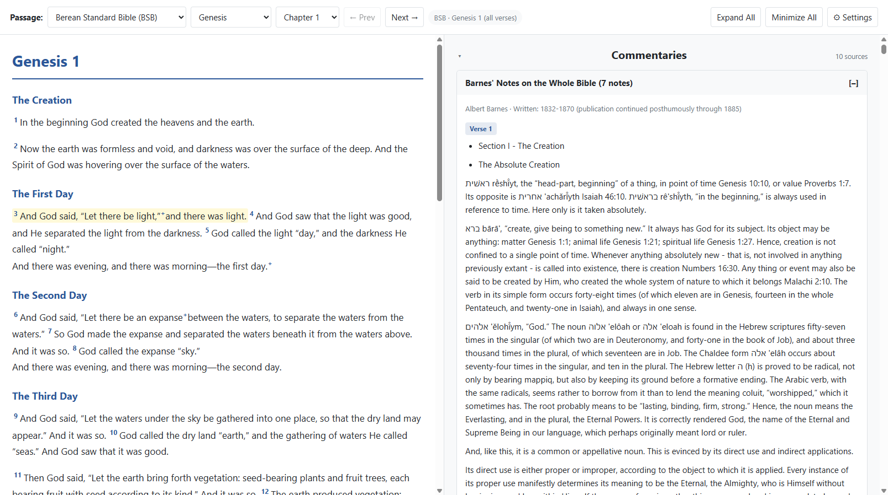

# Open Source Study Bible

A local web-based Bible reader with commentaries, sermons, cross-references,
footnotes, and persistent verse markup. The application uses a Flask backend
to load the compressed source data into a local SQLite cache and serves a
browser UI for reading and exploring passages.

## Screenshot



## Features

- Read available Bible translations and navigate by book and chapter.
- Select one or more verses to filter commentary and sermon entries.
- View footnotes and cross-references for a single selected verse.
- Highlight, underline, or bracket selected verses with preset or custom
  colors. Markup is saved locally in `markup/verse-markup.json.gz`.
- Collapse commentary and sermon sections and individual source cards.
- Adjust appearance with dark mode, accent color, verse-by-verse layout, and
  red-letter display settings.

## Project layout

| Path | Contents |
| --- | --- |
| `app.py` | Flask application, API routes, source loading, and SQLite cache builder. |
| `templates/index.html` | Single-page reader UI, styles, and browser-side behavior. |
| `bibles/` | Gzip-compressed Bible translation JSON files, such as `bsb_translation.json.gz` and `engwebp_translation.json.gz`. See [bibles/README.md](bibles/README.md) for the data format. |
| `commentaries/` | Gzip-compressed commentary sources. See [commentaries/README.md](commentaries/README.md) for the data format. |
| `sermons/` | Gzip-compressed sermon archives; currently includes Spurgeon's sermons. See [sermons/README.md](sermons/README.md). |
| `cross-references/` | Compressed JSON cross-reference sources, including OpenBible and the Treasury of Scripture Knowledge (TSK). See [cross-references/README.md](cross-references/README.md) for the source format. |
| `footnotes/` | Per-translation footnote data. See [footnotes/README.md](footnotes/README.md) for the source format. |
| `interlinear/` | Interlinear source data. To be implemented soon. |
| `markup/` | User verse markup in `verse-markup.json.gz`. See [markup/README.md](markup/README.md). |
| `book-introductions/` | Reserved for book introduction data. To be implemented soon. |
| `cache/` | Generated SQLite reader database; created or refreshed by the app when source files change. |
| `docs/screenshots/` | Screenshots used in project documentation. |

The `old files/` folder contains archived files and is not used by the current
application.

## Run locally

Python 3.9 or newer is recommended. Install Flask if it is not already
available:

```sh
python -m pip install Flask
```

From the project root, start the app:

```sh
python app.py
```

Then open [http://127.0.0.1:5000](http://127.0.0.1:5000). The built-in Flask
server is intended for local development, not production hosting. The
Markdown renderer and HTML sanitizer are loaded from jsDelivr, so those
features require an internet connection in the browser.

## How it works

1. At startup, `app.py` discovers translation archives matching
   `bibles/*_translation.json.gz`, commentary archives matching
   `commentaries/*.json.gz`, sermon archives matching `sermons/*.json.gz`,
   footnotes in `footnotes/*.json.gz`, and cross-reference sources in
   `cross-references/*.json.gz`.
2. The app builds or refreshes `cache/reader.sqlite3` when those source files
   change. The cache is generated data and should not be committed.
3. The browser requests the translations, books, and selected Bible chapter
   from the Flask JSON API. Commentary and sermon results are loaded for the
   current passage and filtered in the UI when verses are selected.
4. Verse markup is kept separately from the database in the compressed JSON
   file under `markup/`, so it persists between app restarts without changing
   the source Bible data.

### Main API routes

- `GET /api/translations` — available translations.
- `GET /api/books/<translation_id>` — books and available chapters.
- `GET /api/bible/<translation_id>/<book_id>/<chapter>` — formatted Bible
  chapter, including attached footnotes and cross-references.
- `GET /api/commentaries/<book>/<chapter>` — commentary entries for a
  passage.
- `GET /api/sermons/<book>/<chapter>` — sermons associated with a passage.
- `GET` and `PUT /api/markup/<translation_id>/<book_id>/<chapter>` — read or
  save verse markup.

## Data and contributions

The `.json.gz` files are gzip-compressed UTF-8 JSON. Keep the schemas and IDs
described in the README files inside each data folder. When adding or replacing
source archives, restart the app so it can refresh its database cache.

The generated SQLite database, Python bytecode, and local saved verse markup
are excluded from Git. The source archives and the documentation for their
formats belong in the repository. Check the source and applicable license
before redistributing or modifying Bible, commentary, sermon, or reference
content.

## TODO

1. [x] Split out the BSB footnotes to its own separate folder so per-version footnotes can be added.
2. [x] Convert cross-references to `.json.gz` files and move TSK to the cross-references folder. Add a setting to toggle one or both of the cross references sources off. Make sure the program accepts other cross reference sources with the proper formatting and filetype if they want to add their own custom ones.
3. Update look and feel of footnotes/cross references popup.
4. Add the ability for users to create their own sermons in Markdown format that get saved to their own `.json.gz` file.
5. Add the ability for the users to create their own commentary in Markdown that gets saved to their own `.json.gz` file.
6. Add the ability for users to write quick notes in plaintext and add it as a section above the commentaries. Add a toggle to turn it on/off in settings.
7. Add a section called "Topics" to the right side and allow users to add their own topics linked to specific verses or commentary entries.
8. Implement interlinear data so when the user clicks on the interlinear button, words with Greek/Hebrew translations are underlined. When the user clicks on any of these words, the Greek/Hebrew word shows up with a definition and references.
